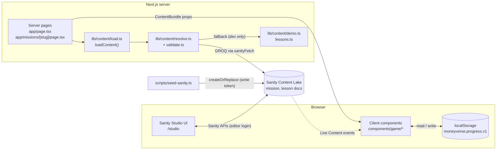

# MoneyVerse architecture

How the app is built, where data lives, and how a request moves through the code. Product rules (economy, rewards, game design) are in [README.md](README.md). Working rules for contributors and AI tools are in [RULES.md](RULES.md). Current status and change log are in [MEMORY.md](MEMORY.md).

Last checked against the code: 2026-10-22 (commit `5463c5f`).

## 1. Overview

MoneyVerse is **one Next.js app** with two parts:

- **The game** (`/`, `/missions/[slug]`): a financial-literacy game for children ages 8–12 that uses fictional game coins only.
- **Sanity Studio** (`/studio`): the content editor, mounted inside the same app. There is no separate Studio project.

There is **no app-owned backend, no API routes, no server database, and no user accounts**.

- **Content** (missions, lessons) lives in **Sanity Content Lake** and is read on the server with GROQ.
- **Player progress** lives in the **browser's `localStorage`**.
- If Sanity is not configured or not reachable, **local development** falls back to built-in demo content. **Production** shows an empty town that explains why.

## 2. Tech stack

| Layer | Technology | Version (package.json) | Notes |
|---|---|---|---|
| Framework | Next.js (App Router) | `16.3.8` | Server Components for pages, `"use client"` for interactive parts. See `AGENTS.md`: this Next.js differs from older versions. Read `node_modules/next/dist/docs/` before changing framework code. |
| UI runtime | React / React DOM | `19.2.8` | Progress store uses `useSyncExternalStore`. |
| Language | TypeScript | `^5` | `strict: true`. Path alias `@/*` → repo root. |
| Styling | Tailwind CSS v4 via `@tailwindcss/postcss` | `^4` | Theme tokens and component classes in `app/globals.css`. |
| Fonts | `next/font/google` | — | Fredoka (display), Nunito (body). |
| Icons | `lucide-react` | `^1.49.0` | |
| CMS | Sanity Studio (`sanity`) | `^6.17.0` | Mounted at `/studio` with `next-sanity/studio`. |
| CMS client | `next-sanity` | `^13.3.4` | `createClient`, `defineLive` (Live Content API), `NextStudio`. |
| Seed client | `@sanity/client` | `^7.12.1` | Used only by `scripts/seed-sanity.ts`. |
| Studio styling | `styled-components` | `^6.1.19` | Needed by Sanity Studio. `compiler.styledComponents` is on in `next.config.ts`. |
| Tests | Vitest | `^5.0.3` | Node environment, `tests/**/*.test.ts`. |
| Lint | ESLint 9 + `eslint-config-next` | `16.3.8` | Flat config in `eslint.config.mjs` (core-web-vitals + typescript). |
| Script runner | `tsx` | `^4.20.6` | Runs the seed script. |
| Hosting | Any Node host (Vercel recommended) | — | `npm run build` then `npm run start`. |

The app does **not** use: a database or ORM, authentication, analytics, payments, a state-management library, a CSS-in-JS library for game UI, or a PWA/service worker. These are not omissions. See [RULES.md](RULES.md).

## 3. Folder structure

```text
Money_verse/
├── app/                                # Next.js App Router
│   ├── layout.tsx                      # Root layout: fonts, metadata, <AppProviders>, <SanityLive>
│   ├── page.tsx                        # "/" town dashboard (Server Component, force-dynamic)
│   ├── missions/[slug]/page.tsx        # "/missions/:slug" mission play (Server Component, force-dynamic)
│   ├── studio/[[...tool]]/
│   │   ├── page.tsx                    # "/studio/*" Studio route (noindex)
│   │   └── studio-client.tsx           # Client: <NextStudio> or a "needs a project id" message
│   ├── error.tsx / loading.tsx / not-found.tsx
│   ├── globals.css                     # Tailwind v4 + theme tokens
│   └── icon.svg
├── components/
│   ├── town.tsx                        # Pip mascot + town scene (SVG)
│   └── game/                           # All client components
│       ├── app-providers.tsx           # Wraps the app in ProgressProvider
│       ├── progress-provider.tsx       # localStorage-backed progress store (useProgress hook)
│       ├── dashboard.tsx               # Town screen: hero, missions scroller, wallet, lessons
│       ├── mission-experience.tsx      # Mission play: choices engine, lemonade engine, results, quiz
│       ├── lesson-card.tsx             # Lesson reader + quiz
│       ├── savings-controls.tsx        # Save / take back / edit goal
│       └── ui.tsx                      # Action, CoinPill, StarRow, ProgressBar, cn()
├── lib/                                # Framework-free logic (unit tested)
│   ├── types.ts                        # Every shared type (Mission, Lesson, PlayerProgress, …)
│   ├── economy.ts                      # Wallet / jar / ledger rules. The only place balances change.
│   ├── finance.ts                      # Pure coin math, savings %, lemonade profit
│   ├── mission-engine.ts               # Choice sessions, outcomes, stars, XP levels
│   ├── progress.ts                     # Save format v1, parsing/recovery, mission + lesson rewards
│   ├── format.ts                       # Coin and label formatting
│   ├── content/
│   │   ├── load.ts                     # server-only: loadContent() used by pages
│   │   ├── resolve.ts                  # Sanity vs demo vs unavailable decision
│   │   ├── validate.ts                 # Runtime validation of Sanity payloads
│   │   ├── demo.ts                     # 3 built-in missions (+ re-exports lessons)
│   │   └── lessons.ts                  # 8 built-in starter lessons
│   └── sanity/                         # server-only Sanity access used by the game
│       ├── client.ts                   # isSanityConfigured(); getSanityClient() (currently unused)
│       ├── live.ts                     # defineLive → sanityFetch + <SanityLive>, disabled without a project id
│       └── queries.ts                  # GROQ: missionsQuery, lessonsQuery
├── sanity/                             # Studio-only code
│   ├── schemaTypes/                    # mission, lesson, objects, review (+ index.ts)
│   ├── structure.ts                    # Desk: In review / Approved / Drafts / All; Play preview tab
│   ├── actions/reviewActions.tsx       # "Send for review", "Approve" document actions
│   ├── components/                     # CoinField input, MissionPreview view
│   ├── env.ts                          # Unused scaffold (see §10)
│   └── lib/                            # Unused scaffold: client.ts, image.ts, live.ts (see §10)
├── sanity.config.ts                    # Studio config (basePath /studio, schema, actions, structure)
├── sanity.cli.ts                       # Sanity CLI config
├── scripts/seed-sanity.ts              # Optional: write demo content to Sanity (dry run by default)
├── tests/                              # Vitest unit tests for lib/
├── public/icons/                       # App icons (192, 512)
├── next.config.ts                      # styled-components compiler flag
├── vitest.config.ts / eslint.config.mjs / postcss.config.mjs / tsconfig.json
├── .env.example                        # All supported env vars, documented
├── README.md                           # Product, setup, content model, economy rules
├── ARCHITECTURE.md                     # This file
├── RULES.md                            # Non-negotiable working rules
├── MEMORY.md                           # Status + change log for the next person or AI tool
├── WRITEUP.md                          # Challenge build notes
├── studio-content-draft.md             # Optional sample content to type into Studio
└── AGENTS.md / CLAUDE.md               # AI tool entry points (Next.js block is auto-managed)
```

## 4. Runtime architecture



**Server/client split**

- Pages are **Server Components**. They call `loadContent()` (marked `server-only`) and pass a plain `ContentBundle` to client components. Both pages set `export const dynamic = "force-dynamic"`, so content is fetched on every request.
- All interactive UI is a **Client Component** under `components/game/`. Client code never talks to Sanity and never reads env tokens.
- `lib/` (except `lib/content/load.ts` and `lib/sanity/*`) is **pure TypeScript** with no React or Next imports. Client and server both use it, and it is what the tests cover.

## 5. Routes

| Route | File | Kind | What it does |
|---|---|---|---|
| `/` | `app/page.tsx` | Server, dynamic | `loadContent()` → `<Dashboard content>` |
| `/missions/[slug]` | `app/missions/[slug]/page.tsx` | Server, dynamic | `loadContent()`, find mission by slug, `notFound()` if missing → `<MissionExperience mission>` |
| `/studio/[[...tool]]` | `app/studio/[[...tool]]/page.tsx` | Server shell + client Studio | Renders `<NextStudio>` if `NEXT_PUBLIC_SANITY_PROJECT_ID` is set, else a setup message. `robots: noindex` |
| (any unknown path) | `app/not-found.tsx` | — | "Not on the town map" page |
| (render error) | `app/error.tsx` | Client | "Pip tripped" with a retry button |

There are **no `app/api/*` route handlers, no Server Actions, and no middleware**.

## 6. Data stores ("database")

The app has no SQL or NoSQL database of its own. It uses two stores.

### 6.1 Sanity Content Lake (content, read-only for the game)

- **Documents:** `mission`, `lesson`. **Objects:** `missionStep`, `choiceOption`, `supplyOption`, `priceOption`, `quizQuestion`, `quizChoice`, `reward`, `lessonSection`, `lessonReward`. All are registered in `sanity/schemaTypes/index.ts`. The field-level tables are in the README "Content model" section.
- **Review workflow:** both documents get `reviewStatus` (`draft` | `inReview` | `approved`) and `reviewerNote` from `sanity/schemaTypes/review.ts`.
- **Visibility rule:** the game sees a document only if it is **published** (the client uses `perspective: "published"`) **and** `reviewStatus == "approved"` (the GROQ filter).
- **Ordering:** `order asc`. **Identity in the game:** `slug.current`, mapped to `slug`.
- **Who writes:** editors in Studio (with their Sanity login), and `npm run seed:sanity -- --yes` (with `SANITY_API_WRITE_TOKEN`). That command replaces only the 11 ids it lists (`mission-*`, `lesson-*`) and never deletes anything.

### 6.2 Browser `localStorage` (player progress, read/write)

- **Key:** `moneyverse.progress.v1` (`STORAGE_KEY` in `lib/progress.ts`). **Format version:** `1`.
- **Shape:** `PlayerProgress` in `lib/types.ts`: `coins`, `xp`, `savings`, `savingsGoalName`, `savingsGoalTarget`, `badges[]`, `missions{slug→MissionRecord}`, `lessons{slug→LessonRecord}`, `totalEarned`, `totalSpent`, `ledger[]` (capped at 40). The README "Progress schema" section has a JSON example.
- **Invariant:** `coins + savings + totalSpent === totalEarned` (`checkInvariants` in `lib/economy.ts`).
- **Recovery:** `readStoredProgress` → `parseProgress` validates every field. Bad JSON, the wrong version, or bad numbers replace the save with a fresh 20-coin wallet and set `recovered: true`, and the town shows a notice. Older v1 saves without `lessons` or totals are upgraded in place.
- Progress is per browser, not synced, and erased when site data is cleared. No personal data is stored.

## 7. Data and "API" flows

The app's only outbound API is Sanity. All game state changes happen in the browser.

### 7.1 Content read flow (every page request)

```text
GET /  or  GET /missions/:slug
  → app/(page).tsx  [Server Component, force-dynamic]
  → loadContent()                         lib/content/load.ts
      projectId = isSanityConfigured() ? NEXT_PUBLIC_SANITY_PROJECT_ID : undefined
      allowDemoFallback = NODE_ENV !== "production"
  → resolveContent(projectId, fetchRemote, log, options)   lib/content/resolve.ts
      fetchRemote = Promise.all([
        sanityFetch({ query: missionsQuery, stega: false }),   lib/sanity/live.ts + queries.ts
        sanityFetch({ query: lessonsQuery,  stega: false }),
      ])
      → validateMissions / validateLessons   lib/content/validate.ts  (drops invalid docs)
  → ContentBundle { source, reason, missions, lessons }
  → <Dashboard content> / <MissionExperience mission>   (client components)
```

**Source decision** (`resolveContent`):

| Situation | Development (`npm run dev`) | Production |
|---|---|---|
| No project id | `demo` (demo missions + lessons) | `unavailable` (empty) |
| Sanity request throws | `demo` | `unavailable` (empty) |
| 0 valid approved missions | `demo` missions; Sanity lessons if any, else demo lessons | `unavailable`, keeps any valid Sanity lessons |
| Missions OK, 0 valid lessons | `sanity` missions + demo lessons | `sanity` missions, no lessons |
| Missions and lessons OK | `sanity` | `sanity` |

The dashboard labels this as **Studio lessons**, **Demo lessons**, or **Lessons unavailable** (`SourceNote` in `dashboard.tsx`). The server log prints `[MoneyVerse] Content source: …`.

### 7.2 Live content refresh

`<SanityLive />` is rendered in `app/layout.tsx`. When a project id is set, `defineLive` subscribes to the Sanity Live Content API, and a publish refreshes the server-rendered content without a redeploy. Without a project id, `lib/sanity/live.ts` swaps in a `sanityFetch` that throws (which `resolveContent` catches) and a `SanityLive` that renders `null`. `stega: false` keeps invisible Visual Editing characters out of the data, so validation does not break on them.

### 7.3 Progress read/write flow (client only)

```text
First client render
  → ProgressProvider (useSyncExternalStore)        components/game/progress-provider.tsx
      server snapshot: { ready: false, progress: null }   (no hydration mismatch)
      client snapshot: readStoredProgress(localStorage[STORAGE_KEY])
      (writes back a fresh or repaired save in a microtask if needed)

Player action (save coins, finish mission, pass lesson quiz)
  → component calls a pure function, which returns a new PlayerProgress or a failure:
      savings-controls.tsx   → economy.transferToSavings / withdrawFromSavings / setSavingsGoal
      mission-experience.tsx → mission-engine (play) → progress.grantMissionReward
      lesson-card.tsx        → progress.recordLessonAttempt
  → useProgress().save(next)
      → localStorage.setItem(STORAGE_KEY, JSON.stringify(next))
      → publish() notifies subscribers → UI re-renders
Reset → save(createFreshProgress())
```

Rules this flow enforces:

- Components **never** compute balances. They call `lib/economy.ts` and `lib/progress.ts`.
- A failed economy action returns the original state unchanged. Nothing is half-applied.
- Mission and lesson coin rewards are idempotent through ledger ids `reward:mission:<slug>` and `reward:lesson:<slug>`.
- Practice coins inside a mission never touch the town wallet. Only the final reward does.

### 7.4 Studio flow

```text
GET /studio/*
  → page.tsx checks NEXT_PUBLIC_SANITY_PROJECT_ID
  → StudioClient → <NextStudio config={sanity.config.ts}>
      Browser ⇄ Sanity APIs directly (editor's own Sanity login; CORS origin must allow credentials)
      Document actions: Send for review → Approve → (Sanity) Publish
      Desk (sanity/structure.ts): Missions/Lessons → In review | Approved | Drafts | All
      Mission docs get a "Play preview" tab (MissionPreview)
```

### 7.5 Seed flow (optional, developer machine)

```text
npm run seed:sanity            → reads .env.local/.env, prints the 11 documents, writes nothing
npm run seed:sanity -- --yes   → @sanity/client.createOrReplace() for each, reviewStatus "approved", published
```

## 8. Environment variables

| Name | Where it is read | Exposed to browser | Purpose |
|---|---|---|---|
| `NEXT_PUBLIC_SANITY_PROJECT_ID` | `lib/sanity/*`, `sanity.config.ts`, `sanity.cli.ts`, studio page, seed | Yes (not a secret) | Turns Sanity on. Blank = demo (dev) or unavailable (prod). |
| `NEXT_PUBLIC_SANITY_DATASET` | same | Yes | Default `production`. |
| `NEXT_PUBLIC_SANITY_API_VERSION` | `lib/sanity/*` | Yes | Default `2026-01-01`. |
| `SANITY_API_READ_TOKEN` | `lib/sanity/live.ts`, `lib/sanity/client.ts` | No | Private datasets. Passed to `defineLive` as server and browser token. next-sanity sends the browser token only in Draft Mode, which this app does not enable. |
| `SANITY_API_WRITE_TOKEN` | `scripts/seed-sanity.ts` only | No | Seeding. Never set it in the deployed app's public env. |

## 9. Testing and quality gates

| Command | What it checks |
|---|---|
| `npm run test` | Vitest, 6 files / 55 tests in `tests/`: content validation and fallback, economy invariants, finance math, lessons, mission engine, progress parsing |
| `npm run typecheck` | `tsc --noEmit` over the whole repo, including Studio code and scripts |
| `npm run lint` | ESLint with Next core-web-vitals + TypeScript rules |
| `npm run build` | Production build; catches Server/Client boundary and route errors |

There are no component or end-to-end tests yet. UI changes are checked by running `npm run dev` and playing the affected screen. See [RULES.md](RULES.md).

## 10. Known inconsistencies and tech debt

These were found while checking this document against the code. None of them breaks the app today.

1. **`sanity/env.ts` and `sanity/lib/{client,image,live}.ts` are unused.** They are `sanity init` scaffolding added in commit `4c18c73`. Nothing imports them. The game uses `lib/sanity/*`, and Studio reads env directly in `sanity.config.ts`. They also disagree with the rest of the app:
   - `sanity/env.ts` defaults the API version to `2026-10-04`. Everything else uses `2026-01-01`.
   - `sanity/env.ts` throws at import time if the dataset or project id is missing, so importing it would break demo mode.
   - `sanity/lib/image.ts` imports `@sanity/image-url`, which is not a direct dependency. It resolves only because `sanity` and `next-sanity` pull it in.
   - The README project map calls `sanity/lib/` the "Studio-side client and live setup", but Studio does not use it.

   Suggested fix: delete these files, or wire them in deliberately. Do not import them as they are.
2. **`getSanityClient()` in `lib/sanity/client.ts` is unused.** Only `isSanityConfigured()` is called. All fetching goes through `sanityFetch` in `lib/sanity/live.ts`.
3. **Two functions are named `transferToSavings`:** a low-level one in `lib/finance.ts` (balances only) and the real one in `lib/economy.ts` (full `PlayerProgress`). `lib/progress.ts#moveCoinsToSavings` wraps the economy version and is used only by tests. UI code must use `lib/economy.ts`.
4. **`spendCoins` (`lib/economy.ts`) has no UI caller.** It is tested and kept for a future shop. The `"spend"` ledger kind exists for it.
